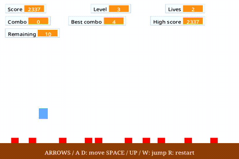
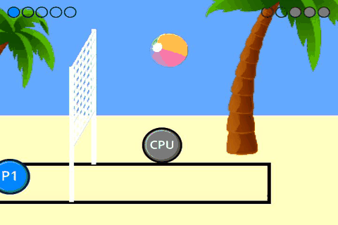
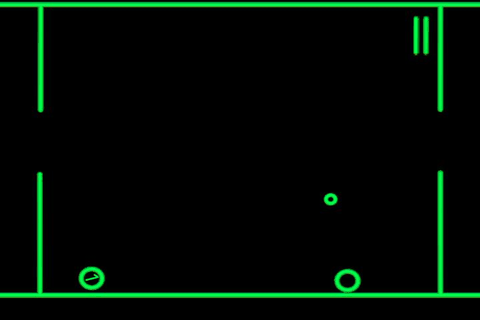
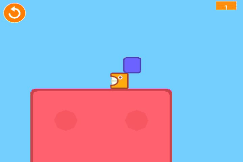
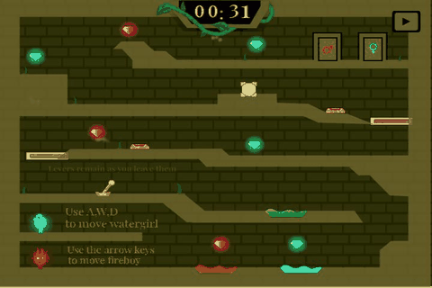
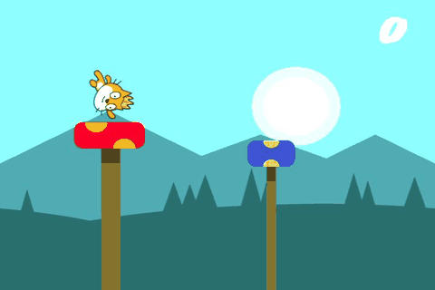
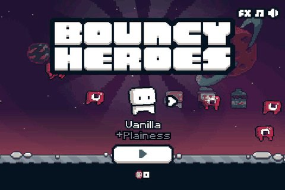
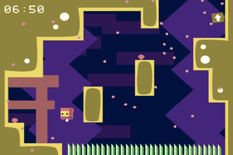
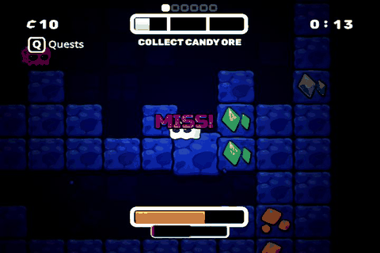
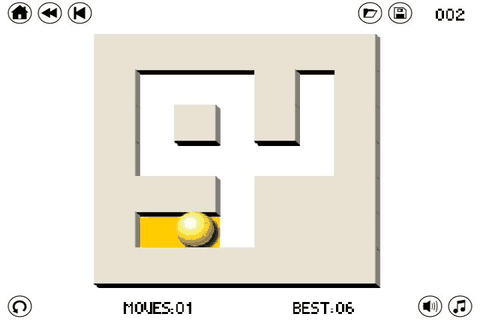

# Original Xbox follow-up for Mike

Updated November 1, 2026. **This recap and its GIFs stay on a feature branch.**
[Main](https://github.com/ZacharyLeahan/scratcheverywhere-nxdk/tree/main) has the
latest merged code; the [game status](https://github.com/ZacharyLeahan/scratcheverywhere-nxdk/blob/main/docs/xbox-game-status.md)
tracks what actually passed.

## Upstream baseline

Our main now includes upstream through
[`c58ca6e6`](https://github.com/ScratchEverywhere/ScratchEverywhere/commit/c58ca6e64d7828a7e8c21373c9ce67ab181e09e6),
including [release 1.3](https://github.com/ScratchEverywhere/ScratchEverywhere/releases/tag/1.3).
The latest syncs add [executable/library recipes](https://github.com/ZacharyLeahan/scratcheverywhere-nxdk/pull/68)
and a [prebuilt executable phase](https://github.com/ZacharyLeahan/scratcheverywhere-nxdk/pull/70);
these do not change the Xbox runtime. The native
NV2A/window/audio work is upstream's baseline. Earlier input-default,
SB2 parsing and resampler fixes are already incorporated; their implementation
files match upstream. They are not being proposed again.

## What remains in our fork beyond upstream

These follow-ups remain beyond upstream. Some predate the 1.3 tag; this is the
**current code difference**, rather than a list of changes authored after release. [Full fork-only comparison](https://github.com/ZacharyLeahan/scratcheverywhere-nxdk/compare/c58ca6e64d7828a7e8c21373c9ce67ab181e09e6...main).

| Scope | Follow-up / review link |
| --- | --- |
| Shared core | [Exact subject alpha for color sensing](https://github.com/ZacharyLeahan/scratcheverywhere-nxdk/commit/7f6015cf8a6d8083eb4939ccd9cffc06fb55048b), with an expanded 58-case reproducer. [Monitor number formatting](https://github.com/ZacharyLeahan/scratcheverywhere-nxdk/commit/d0cbbbfdb29ff5bd08ec7556f4c33efbd44406c9) removes distracting decimal tails. Other platforms still need review. |
| Xbox graphics | Retain exact collision colors, SVG filtering, alpha-correct brightness/pen compositing and clamped texture uploads around your newer effect cache. [1.3 merge/adaptations](https://github.com/ZacharyLeahan/scratcheverywhere-nxdk/pull/61) and [evidence](https://github.com/ZacharyLeahan/scratcheverywhere-nxdk/blob/main/docs/xbox-upstream-1.3.md). Experimental GPU hue stays off by default. |
| Xbox input | [Pause before the next game frame](https://github.com/ZacharyLeahan/scratcheverywhere-nxdk/commit/300b42ddf7ea36e31dce89970deb3b2bfbe06998) and [retain short SDL Back taps](https://github.com/ZacharyLeahan/scratcheverywhere-nxdk/commit/75da9c5b7d485a04a338c234ed1dfb76c6c4133a). Native controller handoff and confirmation-release gating remain. Slow work already running can still delay pause. |
| Xbox homebrew controls | Return to game list/launcher, short Start replay for stopped projects, Restart Xbox / Shut down menus, and **LT + RT + Back + Start** held two seconds. [Implementation](https://github.com/ZacharyLeahan/scratcheverywhere-nxdk/commit/7bd8152f0f8e9d031875e28ca50add7db9aaab9f). A three-second test hold reaches XBMC while the runtime responds; disconnected controls or a hard hang cannot guarantee reset. |
| Individual projects | Reproducible prepared copies, separate from engine changes: [Jumper post-win timer restart](https://github.com/ZacharyLeahan/scratcheverywhere-nxdk/commit/2a52b3114e24c8e35d57976d986fab82c4516730), [Sokoban full-set map/goal repairs](https://github.com/ZacharyLeahan/scratcheverywhere-nxdk/commit/1ecd8978f78cf78c6caa1566e7c0e19cda209492), and the other [preparation scripts](https://github.com/ZacharyLeahan/scratcheverywhere-nxdk/tree/main/scripts). Controller sidecars only map existing keys. |

For upstream review, the small shared fixes and their reproducers are the best
starting point. Keep Xbox backend changes and prepared Scratch projects separate;
the full fork comparison is context, not a request to pull every commit.

## What testing establishes

The 1.3 integration builds, passes native/SDL regressions and both GPU fixtures,
and launches/exits all **21 games** in native xemu. Separate emulator runs complete
Mario, a Retro Racing lap, all 20 Jumper courses and all 13 Sokoban puzzles.

On the physical **128 MB Xbox**, native Maze passes win/replay/two clean returns;
Sokoban completes puzzles 1–11; its saved test ends six moves into twelve.
Those results use the earlier identified executable. The separate 1.3 build now
boots on hardware and plays the new CPU games. Level EATEN! has cleared its
first level, though an intermittent blue-only startup is still open. The primary
dashboard launcher remains the older SDL build. The separate GPU-repair build
now loads Fireboy and Level EATEN, returns both to the browser, and returns to
XBMC normally. This bounded run does not establish repeated startup reliability. **Full qualification of the existing 21 games and 64 MB support are open.**
Nine more games are approved for testing below: **30 is the target, not a pass count.**

Open: native startup/handoffs, later levels/replay, audio and Appel smoothness.
A short Appel sample near 29 FPS does not establish a speed improvement; the
transform-cache experiment stays unmerged. KVM delivery is tracked separately
from game defects. See the [current matrix](https://github.com/ZacharyLeahan/scratcheverywhere-nxdk/blob/main/docs/xbox-game-qualification.md).

Emulator memory check: xemu is configured for 128 MB, but the current guest kernel reports **64 MB**. Memory-sensitive emulator failures need that scope; our physical console has 128 MB.

## Games in action

**Grades describe actual playability on our 128 MB Xbox, not just whether a game boots.**
They are conservative, provisional assessments of the tested game/build; they
are not benchmark scores. Earlier clips use earlier builds. Beach, GlowBall, Candy and Paint use the
separate ordinary 1.3 build; Ninja uses the merged scheduler build with SDL window/audio; Level EATEN, Fireboy, Mushroom Valley and Bouncy
Heroes use its diagnostic variant with read-only logging.
Repeat those loops with the ordinary build before final acceptance. GIF sampling
does not measure game frame rate.

- **A:** smooth, responsive and stable through the main gameplay/ending/replay checks.
- **B+:** tested objective or game loop plus replay works; quality/reliability checks remain.
- **B:** real gameplay works, but progression or important checks are incomplete.
- **C:** playable with significant roughness or limitations. **Appel is C: movement is not yet smooth.**
- **D:** cannot reliably play. No current entry is rated D.

**No A grades yet.** Smoothness/responsiveness are not sufficiently qualified for
an A; unknown does not mean smooth. B+ is not a full-game completion claim.
KVM dropouts/missed input are recorded separately from demonstrated game faults.

The GIFs are **real Xbox footage**, including older sessions, at recorded pace.
They are silent, consistently displayed at **180 × 120**, two games per row.
Written results may come from later tests. “Got working” identifies **core/runtime**,
**Xbox**, **controller profile**, or **prepared-project** work; it does not imply
that every change is new since upstream 1.3. [Capture provenance](mike-gameplay/README.md).

<table>
<tbody>
<tr>
<td width="50%" valign="top">
<h3><a href="https://discord.com/channels/428359196719972353/428399682239332354">Ultra Bird</a></h3>

<strong>Playability: B — Short rounds playable</strong>

<strong>Playable:</strong> A flaps; six pipes / Score 6; loss and Start replay.

<strong>Got working:</strong> Xbox: A/flap and stopped-project replay work; original game unchanged.

<strong>Left:</strong> Longer play, input/handoff reliability and smoothness. Silence is authored.

<a href="https://github.com/ZacharyLeahan/scratcheverywhere-nxdk/blob/main/docs/xbox-ultra-bird.md">Evidence / fix details</a>

</td>
<td width="50%" valign="top">
<h3><a href="https://scratch.mit.edu/projects/1184969400/">Hopper Heros</a></h3>

<strong>Playability: B — Movement and short rounds</strong>

<strong>Playable:</strong> D-pad/stick steer; A jumps; Score 8, loss/retry and menu return.

<strong>Got working:</strong> Profile: supplied the missing D-pad arrow mapping; game unchanged.

<strong>Left:</strong> Sustained progression; early short Start miss; audio and feel.

<a href="https://github.com/ZacharyLeahan/scratcheverywhere-nxdk/blob/main/docs/xbox-hopper.md">Evidence / fix details</a>

</td>
</tr>
<tr>
<td width="50%" valign="top">
<h3><a href="https://scratch.mit.edu/projects/124652800/">Catch Apples</a></h3>

<strong>Playability: B+ — Timed round and replay</strong>

<strong>Playable:</strong> Steer the basket; Score 22, timer ending/replay; native ending also checked.

<strong>Got working:</strong> Profile: D-pad arrows. Project: fixed special-apple +2/−2 scoring race.

<strong>Left:</strong> Repeated native handoffs; sound quality and smoothness.

<a href="https://github.com/ZacharyLeahan/scratcheverywhere-nxdk/blob/main/docs/xbox-catch-apples.md">Evidence / fix details</a>

</td>
<td width="50%" valign="top">
<h3><a href="https://scratch.mit.edu/projects/10128431/">Maze Starter</a></h3>

<strong>Playability: B+ — Win and replay verified</strong>

<strong>Playable:</strong> Complete maze, blocked walls, win, Green Flag replay; two native browser returns.

<strong>Got working:</strong> Profile: arrows. Project: removed the stale win bubble after replay.

<strong>Left:</strong> Repeated boot/handoff stability and feel. No authored sound.

<a href="https://github.com/ZacharyLeahan/scratcheverywhere-nxdk/blob/main/docs/xbox-maze-replay.md">Evidence / fix details</a>

</td>
</tr>
<tr>
<td width="50%" valign="top">
<h3><a href="https://scratch.mit.edu/projects/511466864/">Snake</a></h3>

<strong>Playability: B+ — Steering and game loop</strong>

<strong>Playable:</strong> Four directions, fruit, clock/blade effects; Score 225, collision loss and replay.

<strong>Got working:</strong> Profile: D-pad/stick map to WASD; four-way steering verified; scripts unchanged.

<strong>Left:</strong> Repeat second Exit after adapter disconnect; active audio and feel.

<a href="https://github.com/ZacharyLeahan/scratcheverywhere-nxdk/blob/main/docs/xbox-snake.md">Evidence / fix details</a>

</td>
<td width="50%" valign="top">
<h3><a href="https://scratch.mit.edu/projects/60917032/">Appel</a></h3>

<strong>Playability: C — Playable, movement still rough</strong>

<strong>Playable:</strong> Walk/jump, collect 21/35 apples, use checkpoints and recover after death.

<strong>Got working:</strong> Core/Xbox: terrain and clone fixes. Project: controller-operated menus.

<strong>Left:</strong> Smooth movement; normal-build Xbox Level 1 win/replay; later levels and audio.

<a href="https://github.com/ZacharyLeahan/scratcheverywhere-nxdk/blob/main/docs/xbox-appel.md">Evidence / fix details</a>

</td>
</tr>
<tr>
<td width="50%" valign="top">
<h3><a href="https://scratch.mit.edu/projects/469540467/">Tetris</a></h3>

<strong>Playability: B+ — Core loop and replay</strong>

<strong>Playable:</strong> Rotate, move and drop; ten lines/level-up, four-line clear at 1,200; top-out/replay.

<strong>Got working:</strong> Profile: arrows and A hard-drop. Original game scripts remain unchanged.

<strong>Left:</strong> Longer-session responsiveness/smoothness and subjective music listening.

<a href="https://github.com/ZacharyLeahan/scratcheverywhere-nxdk/blob/main/docs/xbox-tetris.md">Evidence / fix details</a>

</td>
<td width="50%" valign="top">
<h3><a href="https://scratch.mit.edu/projects/12221773/">Frogger</a></h3>

<strong>Playability: B — Six-pad round playable</strong>

<strong>Playable:</strong> Steer across road/river; six pads in one round; loss, replay and relaunch.

<strong>Got working:</strong> Project: repaired seven-pad ending and replay initialization. Profile: arrows.

<strong>Left:</strong> Seven-pad Xbox win/replay; xemu win/alive-state discrepancy; audio and feel.

<a href="https://github.com/ZacharyLeahan/scratcheverywhere-nxdk/blob/main/docs/xbox-frogger.md">Evidence / fix details</a>

</td>
</tr>
<tr>
<td width="50%" valign="top">
<h3><a href="https://scratch.mit.edu/projects/11007566/">Breakout</a></h3>

<strong>Playability: B+ — Board clear and replay</strong>

<strong>Playable:</strong> Steer paddle, clear the board at 1,940, lose/replay and relaunch.

<strong>Got working:</strong> Core/Xbox: pen/color collision support. Project: brick eraser, paddle and serve repairs.

<strong>Left:</strong> Paddle input delivery; faint scaled edge line; smoothness. No authored playback.

<a href="https://github.com/ZacharyLeahan/scratcheverywhere-nxdk/blob/main/docs/xbox-breakout-controller.md">Evidence / fix details</a>

</td>
<td width="50%" valign="top">
<h3><a href="https://scratch.mit.edu/projects/13701368/">PacMan</a></h3>

<strong>Playability: B — Pellets, power-ups and loss</strong>

<strong>Playable:</strong> Turn through corridors, collect pellets, +100 power pellet/blue ghosts; loss/replay.

<strong>Got working:</strong> Core: SB2 costume-name handling; Xbox collision support; arrow profile.

<strong>Left:</strong> Xbox full board/eaten ghost; optional high-score repair not installed; feel.

<a href="https://github.com/ZacharyLeahan/scratcheverywhere-nxdk/blob/main/docs/xbox-pacman.md">Evidence / fix details</a>

</td>
</tr>
<tr>
<td width="50%" valign="top">
<h3><a href="https://scratch.mit.edu/projects/253610111/">Space Invaders</a></h3>

<strong>Playability: B — Shooting and scoring</strong>

<strong>Playable:</strong> Steer/fire, damage shields, hit saucers, lose lives and replay; Score 1,230.

<strong>Got working:</strong> Profile: arrows plus A for start/fire; original game unchanged.

<strong>Left:</strong> Clear all 55 aliens and reach wave two on Xbox; audio/feel. Score alone proves neither.

<a href="https://github.com/ZacharyLeahan/scratcheverywhere-nxdk/blob/main/docs/xbox-space-invaders.md">Evidence / fix details</a>

</td>
<td width="50%" valign="top">
<h3><a href="https://scratch.mit.edu/projects/32219470/">Asteroids</a></h3>

<strong>Playability: B — Combat and loss/replay</strong>

<strong>Playable:</strong> Thrust, turn, fire; Score 9,200, Game Over, replay and relaunch.

<strong>Got working:</strong> Profile: controller actions. Core: repaired cropped SB2 ending text.

<strong>Left:</strong> Further level progression, longer audio listening and smoothness.

<a href="https://github.com/ZacharyLeahan/scratcheverywhere-nxdk/blob/main/docs/xbox-game-qualification.md">Evidence / fix details</a>

</td>
</tr>
<tr>
<td width="50%" valign="top">
<h3><a href="https://scratch.mit.edu/projects/24490009/">Sokoban</a></h3>

<strong>Playability: B — Eleven puzzles complete</strong>

<strong>Playable:</strong> Push crates onto goals; puzzles 1–11 complete; twelve Black restarts checked.

<strong>Got working:</strong> Project: repaired trapped crates, missing row, start position and goal scan.

<strong>Left:</strong> Finish 12–13, wrap/replay/Exit, listening and feel. Saved run ends in twelve.

<a href="https://github.com/ZacharyLeahan/scratcheverywhere-nxdk/blob/main/docs/xbox-sokoban.md">Evidence / fix details</a>

</td>
<td width="50%" valign="top">
<h3><a href="https://scratch.mit.edu/projects/19554088/">2048</a></h3>

<strong>Playability: B+ — Natural win and replay</strong>

<strong>Playable:</strong> Reach 2048 / Score 20,264; continue after victory; natural loss/replay.

<strong>Got working:</strong> Project: A acknowledges victory. Profile: arrows/A; board algorithm unchanged.

<strong>Left:</strong> Missed/duplicate KVM input and held-confirmation handoff; feel. No authored playback.

<a href="https://github.com/ZacharyLeahan/scratcheverywhere-nxdk/blob/main/docs/xbox-2048.md">Evidence / fix details</a>

</td>
</tr>
<tr>
<td width="50%" valign="top">
<h3><a href="https://scratch.mit.edu/projects/26999060/">Retro Racing</a></h3>

<strong>Playability: B — Driving loop playable</strong>

<strong>Playable:</strong> 108 MPH, steering, braking, off-road slowdown, pause and replay.

<strong>Got working:</strong> Profile: driving/handbrake/pause keys; shared audio-continuity repair supports engine sound.

<strong>Left:</strong> Xbox full lap/drift/traffic visuals, sound/feel. Full lap is xemu-only; traffic has no authored collision.

<a href="https://github.com/ZacharyLeahan/scratcheverywhere-nxdk/blob/main/docs/xbox-retro-racing.md">Evidence / fix details</a>

</td>
<td width="50%" valign="top">
<h3><a href="https://scratch.mit.edu/projects/56667360/">Hill Climb Racing</a></h3>

<strong>Playability: B — Vehicles and recovery</strong>

<strong>Playable:</strong> Jeep 1,000; motorcycle 420; fuel pickup, crash, vehicle swap and replay.

<strong>Got working:</strong> Profile: vehicle/restart/pause keys. Core: restored clipped SB2 message artwork.

<strong>Left:</strong> Longer terrain, precise brake/air control, audio and smoothness.

<a href="https://github.com/ZacharyLeahan/scratcheverywhere-nxdk/blob/main/docs/xbox-hill-climb.md">Evidence / fix details</a>

</td>
</tr>
<tr>
<td width="50%" valign="top">
<h3><a href="https://scratch.mit.edu/projects/196684240/">Super Mario Bros.</a></h3>

<strong>Playability: B — Opening level segment</strong>

<strong>Playable:</strong> Walk/jump past four pipes; Goomba/pit deaths recover; replay and relaunch.

<strong>Got working:</strong> Runtime: calendar startup. Project: ordered death, restart and sound cleanup.

<strong>Left:</strong> Full level on Xbox, native Back delay, sound/performance. Full win is xemu-only.

<a href="https://github.com/ZacharyLeahan/scratcheverywhere-nxdk/blob/main/docs/xbox-mario.md">Evidence / fix details</a>

</td>
<td width="50%" valign="top">
<h3><a href="https://scratch.mit.edu/projects/399123680/">Doodle Jump</a></h3>

<strong>Playability: B — Jumping and edge wraps</strong>

<strong>Playable:</strong> Steer above 1,044 m, wrap both edges, fall and automatically replay.

<strong>Got working:</strong> Profile: controller steering; original game unchanged; both wraps verified.

<strong>Left:</strong> Monsters, longer play, audio and smoothness.

<a href="https://github.com/ZacharyLeahan/scratcheverywhere-nxdk/blob/main/docs/xbox-game-qualification.md">Evidence / fix details</a>

</td>
</tr>
<tr>
<td width="50%" valign="top">
<h3><a href="https://scratch.mit.edu/projects/103069687/">Jumper</a></h3>

<strong>Playability: B — Opening courses and recovery</strong>

<strong>Playable:</strong> Levels 1–4, lava death/respawn, level/full restart and browser return.

<strong>Got working:</strong> Core: SVG bounds. Project: controller start/readiness; post-win timer repair ready.

<strong>Left:</strong> Install timer repair; Xbox later levels/victory/replay, audio/feel. Twenty-course completion is xemu-only.

<a href="https://github.com/ZacharyLeahan/scratcheverywhere-nxdk/blob/main/docs/xbox-jumper.md">Evidence / fix details</a>

</td>
<td width="50%" valign="top">
<h3><a href="https://scratch.mit.edu/projects/52769452/">Connect Four</a></h3>

<strong>Playability: B+ — Both players and win types</strong>

<strong>Playable:</strong> Both colors; horizontal/vertical/diagonal wins; full-column rejection and replay.

<strong>Got working:</strong> Core: computed lists/monitors. Project: starting-state/monitor reset. Profile: both control sets.

<strong>Left:</strong> Investigate initial mouse-mode launch; repeat longer sessions/feel. No authored playback.

<a href="https://github.com/ZacharyLeahan/scratcheverywhere-nxdk/blob/main/docs/xbox-game-qualification.md">Evidence / fix details</a>

</td>
</tr>
<tr>
<td width="50%" valign="top">
<h3><a href="https://scratch.mit.edu/projects/1396458859/">Zach’s Spider Adventure</a></h3>

<strong>Playability: B — Stomps, combos and progression</strong>

<strong>Playable:</strong> Move/jump/stomp; Level 6 / Score 7,516; loss/replay and relaunch.

<strong>Got working:</strong> Profile: controller actions and Y restart; original game and 125 assets unchanged.

<strong>Left:</strong> Xbox all-ten-level victory/post-win replay, audio/feel. Full victory is xemu-only.

<a href="https://github.com/ZacharyLeahan/scratcheverywhere-nxdk/blob/main/docs/xbox-spider-adventure.md">Evidence / fix details</a>

</td>
<td width="50%" valign="top">
<h3><a href="https://scratch.mit.edu/projects/333452181/">Beach Volleyball</a></h3>

<strong>Playability: B — CPU match playable; 2P pending</strong>

<strong>Playable:</strong> X starts Easy CPU; D-pad moves, A jumps; scored twice, natural 2–5 loss; Green Flag/X replay and browser return.

<strong>Got working:</strong> Prepared project/profile: X-to-CPU shortcut and on-screen controls; original gameplay/assets preserved.

<strong>Left:</strong> Independent two-player controls; direct ending-screen replay; audio, measured smoothness and longer testing. Short Start does not replay this ending; use Back → Green Flag.

<a href="#next-nine-target-pack-of-30">New-game progress and limits</a>

</td>
</tr>
<tr>
<td width="50%" valign="top">
<h3><a href="https://scratch.mit.edu/projects/112176502/">GlowBall</a></h3>

<strong>Playability: B — CPU match and replay</strong>

<strong>Playable:</strong> X starts CPU; directions/A jump; natural 2–5 loss, X replay and browser return.

<strong>Got working:</strong> Prepared project/profile: CPU shortcut and controls hint; original gameplay preserved.

<strong>Left:</strong> Independent 2P, player win, audio/smoothness and longer play.

</td>
<td width="50%" valign="top">
<h3><a href="https://scratch.mit.edu/projects/704676520/">Level EATEN!</a></h3>

<strong>Playability: C — First level cleared; startup issue open</strong>

<strong>Playable:</strong> Walk/jump/eat/grow; first-level win → Level 2; Y reset, Green Flag replay and browser return. Candidate xemu also clears Level 2 → Level 3.

<strong>Got working:</strong> Profile only. Stepping aside lets the last cube fall from the player’s head; no eating-runtime fix was needed.

<strong>Left:</strong> Intermittent blue-only startup; repeat win/replay on ordinary build, later levels and audio/smoothness.

</td>
</tr>
<tr>
<td width="50%" valign="top">
<h3><a href="https://scratch.mit.edu/projects/571560558/">Fireboy and Watergirl</a></h3>

<strong>Playability: C — Full Xbox level clear still open</strong>

<strong>Playable:</strong> Both characters move/jump; natural Game Over, Black/R retry, B back to the level selector after loss, and browser return on Xbox.

<strong>Got working:</strong> Prepared project: level selector preserves locks; <a href="https://github.com/ZacharyLeahan/scratcheverywhere-nxdk/pull/69">B results-menu shortcut</a> reuses the authored action. Release/fresh-press gating prevents held movement from skipping endings. xemu clears level 1/all seven gems and tests the earned Level 2/retry/menu loop.

<strong>Left:</strong> Full Xbox clear and next-level loop. Main misses blue-water death; a separate <a href="https://github.com/ZacharyLeahan/scratcheverywhere-nxdk/commit/5dea170994543b8df3fc23c1790edc46a6a73985">Xbox collision candidate</a> passes this hazard twice on hardware, pending full-level regression. Repeated startup, later levels, independent two-pad support and audio/smoothness remain open.

</td>
<td width="50%" valign="top">
<h3><a href="https://scratch.mit.edu/projects/285730673/">Mushroom Valley</a></h3>

<strong>Playability: B — Scored run and controller retry</strong>

<strong>Playable:</strong> Hold/release A; two scored landings, natural loss, A retry/new round, renewed jump and browser return.

<strong>Got working:</strong> Prepared project: A activates the existing mouse-only Retry gate; ending hint added.

<strong>Left:</strong> Repeat prepared copy on ordinary build; longer runs and audio/smoothness.

</td>
</tr>
<tr>
<td width="50%" valign="top">
<h3><a href="https://scratch.mit.edu/projects/173918262/">Bouncy Heroes</a></h3>

<strong>Playability: B — Scored combat and replay</strong>

<strong>Playable:</strong> Directions + A dash, B slam; Score 10 / four coins; natural Game Over, A menu/replay and browser return.

<strong>Got working:</strong> Existing keys mapped in a controller profile; no project or core patch.

<strong>Left:</strong> Ordinary-build repeat, character/menu coverage, audio/smoothness and longer play.

</td>
<td width="50%" valign="top">
<h3><a href="https://scratch.mit.edu/projects/404349977/">Ninja Climb</a></h3>

<strong>Playability: B — First course cleared twice</strong>

<strong>Playable:</strong> X starts/dashes, A jumps; first course cleared twice, natural spike death/respawn, Green Flag replay and browser return.

<strong>Got working:</strong> Merged shared scheduler repair now advances course 1 → 2 on Xbox too, using the unchanged original project.

<strong>Left:</strong> Later courses, measured smoothness, audio and longer sessions; native backend startup remains open.

</td>
</tr>
<tr>
<td width="50%" valign="top">
<h3><a href="https://scratch.mit.edu/projects/1385416673/">Candy Caves</a></h3>

<strong>Playability: B — Mining, loss and replay</strong>

<strong>Playable:</strong> Directions + A mine; candy earned, natural Game Over, A replay/new map, renewed mining and browser return.

<strong>Got working:</strong> Project-side compatibility workaround reconnects map-clone initialization; original assets/credits retained. The original loads in the official Scratch VM; the current 64 MB xemu guest faults during allocation. The cause on Xbox remains under investigation.

<strong>Left:</strong> Later progression/upgrades, measured smoothness, audio and longer sessions.

</td>
<td width="50%" valign="top">
<h3><a href="https://scratch.mit.edu/projects/314731988/">Paint the Maze</a></h3>

<strong>Playability: B — Three puzzle wins and reset/resume</strong>

<strong>Playable:</strong> A starts; D-pad clears puzzles 1–3 in 5, 6 and 17 moves; Y reset, B Home/A resume and browser return pass.

<strong>Got working:</strong> Prepared A Play/B Home shortcuts reuse authored click handlers; Y maps puzzle reset.

<strong>Left:</strong> Later puzzles, controller Save/Load access, audio/smoothness and longer sessions.

</td>
</tr>
</tbody>
</table>

Hopper links to the original game; we tested its Everywhere variant. Ultra Bird's
link is the example Discord channel because its standalone project URL was not
recorded. Full Appel Level 1 completion is currently emulator evidence; the
normal physical run has not yet repeated that win.

## Next nine: target pack of 30

**All nine are installed; 30 is the target, not a qualified-game count.**
Candy’s loading workaround and Paint’s controller menu now pass their Xbox gameplay
loops. All 30 entries have real Xbox clips. No new game has earned an A; smoothness,
audio and extended stability remain unqualified. This console has 128 MB.

| Game | Current Xbox result / next check |
| --- | --- |
| [Beach Volleyball](https://scratch.mit.edu/projects/333452181/) | **B:** CPU scored match/loss, Green Flag replay/return. Independent 2P pending. |
| [GlowBall](https://scratch.mit.edu/projects/112176502/) | **B:** CPU scored match/loss, title/X replay/return. Independent 2P pending. |
| [Level EATEN!](https://scratch.mit.edu/projects/704676520/) | **C:** Xbox first-level win → Level 2, reset/replay/return. Candidate xemu also reaches Level 3 after Green Flag/Y retry. Intermittent Xbox startup remains open. |
| [Fireboy and Watergirl](https://scratch.mit.edu/projects/571560558/) | **C:** Xbox selection/start, hazard loss, Black retry, B results Menu and browser return pass. xemu clears level 1/all gems and the earned Level 2/menu/retry loop. Main misses blue-water death; a [feature candidate](https://github.com/ZacharyLeahan/scratcheverywhere-nxdk/commit/5dea170994543b8df3fc23c1790edc46a6a73985) passes it twice on Xbox, pending full-level regression. Full Xbox clear, repeated startup, 2P and quality checks remain open. |
| [Paint the Maze](https://scratch.mit.edu/projects/314731988/) | **B:** First three puzzle wins; Y reset, B Home/A resume at level 4 and browser return on Xbox. Later puzzles, Save/Load and quality checks open. |
| [Candy Caves](https://scratch.mit.edu/projects/1385416673/) | **B:** Prepared repair loads; mining earns candy; natural Game Over, explicit A replay/new map, renewed mining and browser return on Xbox. Original-project engine compatibility, later progression and quality checks open. |
| [Bouncy Heroes](https://scratch.mit.edu/projects/173918262/) | **B:** Dash/slam, Score 10/four coins, natural loss/A replay/return. |
| [Ninja Climb](https://scratch.mit.edu/projects/404349977/) | **B:** First course cleared twice on Xbox, natural death/respawn, Green Flag replay and browser return. Later courses and quality checks open. |
| [Mushroom Valley](https://scratch.mit.edu/projects/285730673/) | **B:** Score 2/loss, prepared A retry, renewed jump/return. |

[Merged project helpers (PR #65)](https://github.com/ZacharyLeahan/scratcheverywhere-nxdk/pull/65)
prepare separate controller-ready copies for Beach/GlowBall CPU menus, Mushroom
retry, Fireboy’s level selector, Candy’s clone workaround and Paint’s Play/Home menu.
These are **prepared-project/profile changes**, separate from engine changes;
original assets/credits remain. The named Xbox checks above pass, with quality
and later-progression limits still open.

[Merged shared core repair (PR #66)](https://github.com/ZacharyLeahan/scratcheverywhere-nxdk/pull/66)
fixes Ninja’s Reset → clear sequence. The reference fixture passes both engines
in xemu and on the Xbox using SDL. Ninja clears course 1 on the Xbox, then
repeats that clear after Green Flag restart. No Ninja assets changed. Native
startup reliability, later courses and quality checks remain open.

[Merged Xbox SDL GPU repair (PR #67)](https://github.com/ZacharyLeahan/scratcheverywhere-nxdk/pull/67):
Fireboy could overrun the 512 KiB command buffer. The capacity guard passes the
negative-control stress test, xemu full-level clear, and a real Xbox
Fireboy → browser → Level EATEN → browser → XBMC run with no DMA error observed.
This is a startup/cleanup result, not a performance or full-pack pass.

[Merged Fireboy results controls (PR #69)](https://github.com/ZacharyLeahan/scratcheverywhere-nxdk/pull/69)
add B Menu to the prepared project. On Xbox, natural loss/Black retry/B Menu pass.
xemu additionally checks win → earned next level, held-B release gating and replay.
The original level physics, locks, assets and credits are preserved.

For unclear behavior, we compare official Scratch, Xbox and selectively our Mac port.
This led to an [Xbox-specific alpha-collision candidate](https://github.com/ZacharyLeahan/scratcheverywhere-nxdk/commit/5dea170994543b8df3fc23c1790edc46a6a73985):
blue-water death passes twice on hardware; red-pool safety, Retry and browser return
also pass. Level EATEN moves/jumps and collects a cube. **This candidate stays off main
while full-level and broader game regression remain open.**

Independent simultaneous two-player input still needs backend/per-port binding
work; the current backend exposes one active pad. Fireboy’s clip uses two keysets
on one controller. Repeat diagnostic-build results on the ordinary build before
final acceptance. Further fresh launches, meaningful progression, endings/replay,
audio and measured smoothness remain the acceptance work.

## Why adding games is cumbersome

**The browser selects installed games. There is no in-app Scratch search,
download or add flow.** Download the `.sb2`/`.sb3` on a computer, return to XBMC,
FTP it (and any controller sidecar) into `E:\ScratchEverywhere\`, then relaunch.
That transfer/setup loop is what I meant by tricky when playing with my daughter.

An archive receiver/import screen and easy arrows/WASD presets would help. A
per-project Controls editor already exists; make it easier to find. Importing a
project would not guarantee its compatibility.

